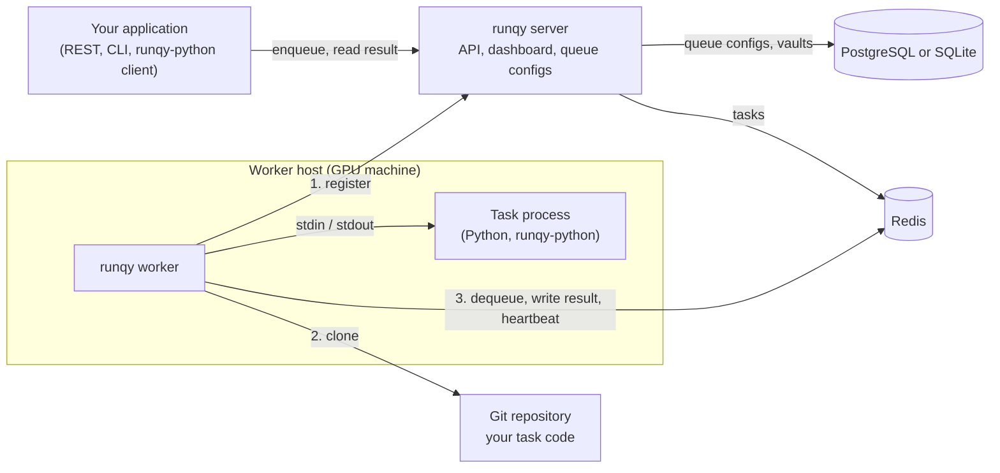
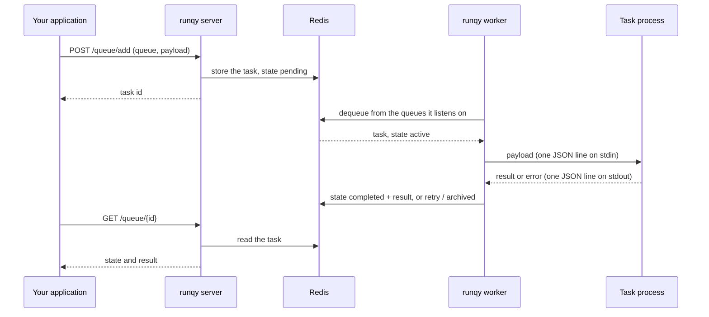

# Architecture

This page explains what each part of runqy does, where your code lives, and what happens to a task between the moment you enqueue it and the moment you read its result. It ends with the vocabulary used throughout the docs.

## The components



| Component | What it does |
|-----------|--------------|
| **runqy server** | One Go binary. It holds the queue configs, exposes the REST API and the `runqy` CLI, serves the dashboard at `/monitoring`, and answers workers that register. It never runs your code. |
| **runqy worker** | One Go binary per machine that runs tasks. It starts with three settings (server URL, API key, queues) and receives everything else from the server. It supervises the task process and moves tasks between Redis and that process. |
| **Task process** | Your Python code, started by the worker. It uses the runqy-python package (`@task`, `@load`, `run()`) to receive a payload and return a result. |
| **Redis** | Holds the tasks, their state and results, and the worker heartbeats. The server and every worker connect to it. |
| **PostgreSQL or SQLite** | Holds what must survive a Redis flush: queue configs, vaults, autoscaling providers and alert settings. Only the server connects to it. |

Your application talks only to the server. Workers talk to the server once, at startup, then work against Redis. That is why workers need network access to both the server and Redis, and why the Redis credentials live only in the server's configuration: the server hands them to each worker that registers.

## Where your code lives

Nothing about your task is built into the worker binary or image.

1. Your task code lives in a git repository, with a `requirements.txt` next to it.
2. A **queue config** on the server names that repository: the URL, the branch, an optional sub-directory (`code_path`) and the command that starts the code (`startup_cmd`).
3. A worker that registers for the queue receives that config, clones the repository, creates a virtualenv, installs the dependencies and runs the startup command.

```yaml
queues:
  inference:
    priority: 5
    deployment:
      git_url: "https://github.com/example/my-tasks.git"
      branch: "main"
      code_path: "inference"
      startup_cmd: "python main.py"
```

To ship a new version of your task you push to the branch, then restart the workers or send them a code update (see [Worker control](../guides/worker-control.md)). The same worker binary can serve any queue. All keys of a queue config are listed in the [queue configuration reference](../reference/queue-config.md).

## The life of a task



1. Your application enqueues a task through the server: REST, CLI or the Python client. See [Enqueueing tasks](../guides/enqueueing-tasks.md).
2. The server checks that the queue exists, resolves the queue's lifecycle limits (retries, TTLs, timeouts) and writes the task to Redis in the `pending` state.
3. A worker listening on that queue takes the task. It is now `active`.
4. The worker passes the payload to the task process, which calls your `@task` function.
5. On success the task becomes `completed`. On failure it goes to `retry` when the error is retryable and retries remain, otherwise to `archived`.
6. Your application reads the state and the result from the server. The result is kept only when the queue config sets `redis_storage: true`. See [Getting results](../guides/result-delivery.md).

The wire format between the worker and the task process is described in the [Python SDK reference](../reference/python-sdk.md). You only need it if you write a task process without runqy-python.

## What is stored where

| Data | Store | Lifetime |
|------|-------|----------|
| Queue configs (deployment, sub-queues, limits, autoscaling, alert overrides) | PostgreSQL or SQLite | Until you delete them. YAML files are loaded into the database at server start and on reload. |
| Vaults (encrypted secrets) | PostgreSQL or SQLite | Until you delete them |
| Tasks: payload, state, result | Redis | Until their TTL expires (`ttl_completed`, `ttl_archived`, see [Task lifecycle](../guides/task-lifecycle.md)) |
| Worker heartbeats and recent task process logs | Redis | 30 seconds after the worker's last heartbeat |

Losing Redis loses the tasks in flight and their results, not your configuration. Losing the database loses the configuration, not the tasks. The Redis key names matter only if you inspect Redis by hand or enqueue without the server; the one case the docs cover is in [Enqueueing tasks](../guides/enqueueing-tasks.md#writing-to-redis-directly).

## Vocabulary

| Term | Meaning |
|------|---------|
| **Parent queue** | A named queue such as `inference`. It owns one deployment: one repository, one startup command. |
| **Sub-queue** | A priority lane of a parent queue, written `parent.sub`, for example `inference.high`. Every task is enqueued to a sub-queue. A parent queue without explicit sub-queues has one, named `default`. See [Queues](queues.md). |
| **Queue config** | The definition of a parent queue on the server: its sub-queues and priorities, its deployment and optional blocks (limits, autoscaling, alerts). Written as YAML or created through the API, CLI or dashboard. |
| **Deployment** | The part of a queue config that tells workers which code to run: `git_url`, `branch`, `code_path`, `startup_cmd`, `mode`, vaults. |
| **Worker** | One running `runqy-worker` process. It serves one or more parent queues and runs one task process per parent queue. See [Workers](workers.md). |
| **Worker id** | `host:pid` of the worker process, for example `gpu-node-1:1`. Used by the CLI, the dashboard and worker control. |
| **Task process** | The Python process the worker starts with `startup_cmd` and supervises. |
| **Task** | One unit of work: a JSON payload sent to one sub-queue. It has an id, returned when you enqueue it. |
| **Task state: `pending`** | Waiting in its sub-queue for a worker. |
| **Task state: `active`** | Taken by a worker and being processed. |
| **Task state: `retry`** | Failed with a retryable error and waiting for its next attempt. |
| **Task state: `completed`** | Finished successfully. |
| **Task state: `archived`** | Failed for good: the error was not retryable, the retries ran out, or the task waited longer than `pending_timeout`. |
| **Vault** | A named set of encrypted key-value pairs stored by the server. A queue config lists the vaults whose entries become environment variables of the task process. See [Vaults](../guides/vaults.md). |

## Next steps

- [Queues, sub-queues and priorities](queues.md)
- [Workers: bootstrap, modes and crash recovery](workers.md)
- [Your first task](../getting-started/first-task.md)
