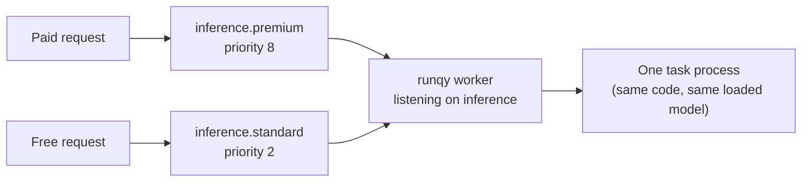

# Queues, sub-queues and priorities

A queue in runqy is more than a list of tasks: it also says which code runs them. This page explains parent queues and sub-queues, how names such as `inference` and `inference.high` resolve, and how priorities decide which task a worker takes next.

## What a queue is

A **parent queue** ties three things together:

- one **deployment**: a git repository, a branch and a startup command;
- one **task process** per worker, started from that deployment;
- one or more **sub-queues**, which hold the tasks.

So all tasks of a parent queue are handled by the same code. Two different models or two different pipelines are two parent queues.

## Sub-queues are priority lanes

A sub-queue is a lane inside a parent queue. All lanes feed the same task process; they differ only by priority. The usual reason to have several is to let some callers pass others: paying users go to `inference.premium`, free users to `inference.standard`, and the same model serves both.



```yaml
queues:
  inference:
    sub_queues:
      - name: premium
        priority: 8
      - name: standard
        priority: 2
    deployment:
      git_url: "https://github.com/example/my-tasks.git"
      branch: "main"
      startup_cmd: "python main.py"
```

Lifecycle limits, vaults, autoscaling and alert settings are set on the parent queue and apply to all its sub-queues. The YAML keys are in the [queue configuration reference](../reference/queue-config.md).

## Naming and the `.default` rule

A full queue name is `parent.sub`, for example `inference.premium`. Neither part may contain a dot. Tasks always live in a sub-queue.

A parent queue declared with a single `priority` and no `sub_queues` gets exactly one sub-queue, named `default`:

```yaml
queues:
  thumbnails:
    priority: 5        # creates thumbnails.default with priority 5
    deployment:
      git_url: "https://github.com/example/my-tasks.git"
      branch: "main"
      startup_cmd: "python main.py"
```

When you enqueue to a name without a dot, the server appends `.default` before looking the queue up:

| You enqueue to | The queue was declared with | Result |
|----------------|-----------------------------|--------|
| `thumbnails` | `priority` only | Goes to `thumbnails.default` |
| `thumbnails.default` | `priority` only | Goes to `thumbnails.default` |
| `inference.premium` | `sub_queues: premium, standard` | Goes to `inference.premium` |
| `inference` | `sub_queues: premium, standard` | Rejected: there is no `inference.default` |
| `inference.vip` | `sub_queues: premium, standard` | Rejected: unknown sub-queue |

A rejected enqueue returns HTTP 404 with the resolved name:

```json
{"errors": ["queue not found: inference.default"]}
```

!!! warning
    Declaring `sub_queues` does not create a `default` lane. If callers enqueue to the bare parent name, add a sub-queue named `default` to the list.

## What a worker listens on

A worker is told which queues to serve with `RUNQY_QUEUES` (or `worker.queues` in `config.yml`). Each entry is either a parent name or a full sub-queue name:

| Setting | The worker takes tasks from |
|---------|-----------------------------|
| `RUNQY_QUEUES=inference` | Every sub-queue of `inference` |
| `RUNQY_QUEUES=inference.premium` | Only `inference.premium` |
| `RUNQY_QUEUES=inference.premium,inference.standard` | Those two sub-queues, with one shared task process |
| `RUNQY_QUEUES=inference,thumbnails` | Every sub-queue of both parents, with one task process per parent |

Listing a sub-queue explicitly is how you reserve machines: a few workers on `inference.premium` only never spend time on standard traffic. If a parent name and one of its sub-queues are both listed, the parent wins and the worker listens on all its sub-queues.

A worker refuses to start when none of the sub-queues it lists exists on the server. A listed sub-queue that does not exist, next to others that do, is logged as a warning and ignored.

## How priorities are applied

Priorities are weights, not ranks. Each time a worker is free, it draws a new polling order over the sub-queues it listens on. A sub-queue comes first in that order with a probability equal to its priority divided by the sum of all priorities. The worker then takes the first task available in that order.

Take three sub-queues with a backlog in each:

| Sub-queue | Priority | Polled first |
|-----------|----------|--------------|
| `inference.high` | 6 | 6 / 10 = 60% of the time |
| `inference.standard` | 3 | 3 / 10 = 30% |
| `inference.low` | 1 | 1 / 10 = 10% |

Over many tasks, about 60% of what the worker runs comes from `high`, 30% from `standard` and 10% from `low`. Three consequences follow:

- **No starvation.** A low-priority sub-queue is always served, only less often.
- **Empty lanes cost nothing.** If `high` is empty, the worker takes the next sub-queue in the order. Between `standard` and `low`, `standard` then comes first 3 times out of 4.
- **Priorities matter only under backlog.** An idle worker takes any task the moment it arrives, whatever its sub-queue.

Only the ratio between priorities counts: `6` and `3` behave like `2` and `1`. A priority must be at least 1.

### Strict priority

If a lower lane must wait until the higher lanes are empty, set `strict_priority: true` on the parent queue:

```yaml
queues:
  inference:
    strict_priority: true
    sub_queues:
      - name: premium
        priority: 8
      - name: standard
        priority: 2
    deployment:
      git_url: "https://github.com/example/my-tasks.git"
      branch: "main"
      startup_cmd: "python main.py"
```

The worker then always polls this parent's sub-queues in descending priority (ties broken by name). `standard` is served only when `premium` is empty, so a steady flow of premium tasks can starve it. Use strict mode when that is what you want, for example interactive requests ahead of a batch backlog.

### Priority between parent queues

Priorities are compared across everything one worker listens on. A worker serving `inference` and `thumbnails` draws one order over all their sub-queues, using the same weights. Strict mode does not change this: it only fixes the order of a strict parent's sub-queues relative to each other, while the order between different parents stays weighted.

Priorities have no effect between workers. If `inference` and `thumbnails` are served by separate workers, each worker only ever looks at its own queues.

## Pausing a queue

Pausing stops workers from taking tasks out of a sub-queue. Tasks already running finish, and new tasks can still be enqueued; they wait in `pending` until you unpause.

```bash
runqy queue pause inference.standard
runqy queue unpause inference.standard
```

Pausing applies to one sub-queue, named in full. To stop a whole parent queue, pause each of its sub-queues. To stop one worker rather than a queue, drain it instead: see [Worker control](../guides/worker-control.md).

## Related

- [Queue configuration reference](../reference/queue-config.md)
- [Enqueueing tasks](../guides/enqueueing-tasks.md)
- [Workers: bootstrap, modes and crash recovery](workers.md)
- [Task lifecycle](../guides/task-lifecycle.md)
