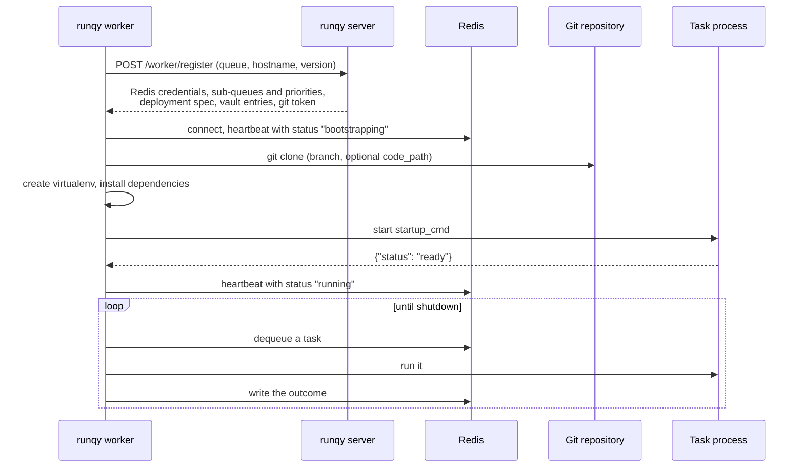
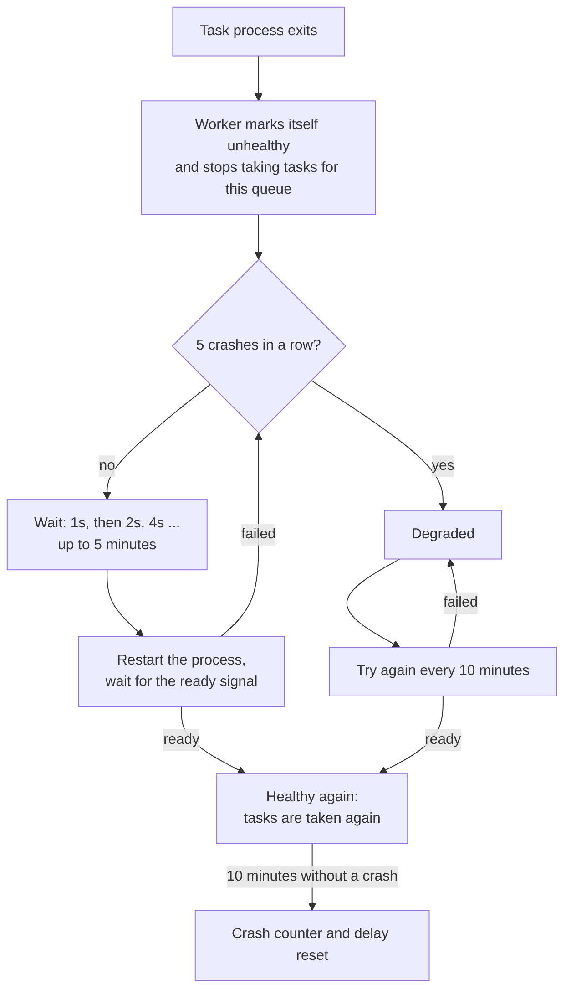

# Workers

A runqy worker is a single binary that turns a machine into a consumer of one or more queues. This page explains what it does from startup to shutdown: the bootstrap, the two execution modes, the heartbeat, crash recovery and graceful shutdown.

To run one, see [Deploying workers](../guides/deploying-workers.md). Every setting is in the [worker configuration reference](../reference/worker-config.md).

## Bootstrap

A worker starts with three pieces of information: the server URL, an API key and the queues to serve. Everything else comes from the server.

For each parent queue it serves, the worker:

1. **Registers** with `POST /worker/register`. The server answers with the Redis address and password, the sub-queues and their priorities, the deployment (`git_url`, `branch`, `code_path`, `startup_cmd`, `mode`, `startup_timeout_secs`, `redis_storage`), the decrypted entries of the queue's vaults and, if the queue config has a `git_token`, the token to clone with. Server contact is retried (3 attempts, 5 seconds apart by default).
2. **Connects to Redis** and starts its heartbeat with the status `bootstrapping`, so the worker is visible on the dashboard while it installs.
3. **Clones the code** into `<deployment dir>/<parent queue>` (the deployment directory defaults to `./deployment`). The clone is shallow. With a `code_path`, only that sub-directory is checked out.
4. **Creates a virtualenv** in `.venv` inside the code directory and **installs dependencies**: `pip install -r requirements.txt`, or `poetry install` when `pyproject.toml` has a `[tool.poetry]` section. A project that is not a Poetry project and has no `requirements.txt` gets no dependencies installed.
5. **Starts the task process** with `startup_cmd`, in the code directory. The worker's own environment is passed on, with the virtualenv first in `PATH` and each vault entry added as an environment variable.
6. **Waits for the ready signal**: the line `{"status": "ready"}` on the process's standard output, which runqy-python prints once your `@load` function has returned.
7. **Processes tasks.** The heartbeat status becomes `running`.

In `one_shot` mode, steps 5 and 6 happen for each task instead of once at startup.

If any step fails, the worker logs `Bootstrap failed: ...` and exits. Run it under something that restarts it (Docker restart policy, systemd).

### The startup command

`startup_cmd` is split on spaces (quotes group words) and executed directly, without a shell: pipes, `&&` and variable expansion do not work. When the first word is `python` or `python3`, the worker replaces it with the virtualenv's interpreter.

### Startup timeout

The worker waits `startup_timeout_secs` for the ready signal, 60 seconds when the queue config does not set it. Loading a large model takes longer: set the value in the queue config to cover your worst case, including a cold download of the weights. When the timeout passes, the process is stopped and the start counts as failed.

### What the host needs

| Requirement | Why |
|-------------|-----|
| `git` in `PATH` | To clone the task code |
| `python3` or `python` (Python 3) in `PATH`, with the `venv` module | To create the virtualenv. If `uv` is in `PATH`, the worker creates the virtualenv with `uv venv` first and falls back to `python -m venv`. |
| `poetry` in `PATH` | Only for Poetry projects |
| Network access to the runqy server, to Redis and to the git host | Registration, tasks, clone |

The published images already contain these:

| Image | Based on | Contains |
|-------|----------|----------|
| `ghcr.io/publikey/runqy-worker:<version>` (same as `<version>-minimal`) | Alpine 3.19 | git, curl, Python 3, pip. linux/amd64 and linux/arm64. |
| `ghcr.io/publikey/runqy-worker:<version>-inference` (also tagged `inference`) | `pytorch/pytorch:2.11.0-cuda12.8-cudnn9-runtime` | git, PyTorch with CUDA, `uv`, C/C++ build tools. linux/amd64 only. |

`<version>` is the release tag, for example `v0.4.2`.

By default the virtualenv is created with `--system-site-packages`, so packages already installed in the image (PyTorch in the inference image) are reused instead of downloaded again. Set `use_system_site_packages` to `false` for an isolated virtualenv.

### Restarting a worker

The deployment directory is kept when the worker stops. On the next start, the worker finds the existing clone, runs `git pull --ff-only`, reuses the virtualenv and runs the dependency install again, which is fast when nothing changed.

Two consequences:

- If the pull fails (no network, a force-pushed branch), the worker logs a warning and **starts with the code it already has**.
- Changing the queue's `branch` does not move an existing clone. Send a code update ([Worker control](../guides/worker-control.md)) or delete the deployment directory to get a fresh clone.

In a container without a volume, the directory is lost with the container and every start is a fresh clone and install.

## Execution modes

The queue config chooses how tasks are run with `deployment.mode`. The value is `long_running` (the default) or `one_shot`.

| | `long_running` | `one_shot` |
|---|---|---|
| Task process | One per parent queue, started at bootstrap, kept alive | A new one for each task, exits afterwards |
| `@load` | Runs once; its return value is passed to every task | Runs for each task |
| In your code | `run()` | `run_once()` |
| Cost per task | None beyond the task itself | Interpreter start, imports and `@load` |
| State between tasks | Kept in memory (model, connections) | None |
| A task that leaks memory or corrupts state | Affects the following tasks | Is gone when its process exits |

Use `long_running` whenever startup is expensive: a model loaded on a GPU is the typical case. Use `one_shot` for short, independent tasks where a clean process each time is worth a second of startup, or for code you do not trust to stay healthy across tasks.

### Concurrency

`concurrency` (default 1) is the number of tasks one worker holds at the same time, across all the queues it serves. What that means depends on the mode:

- **`one_shot`**: each task in progress has its own process, so `concurrency: 4` runs up to four processes in parallel.
- **`long_running`**: there is still a single task process, and a runqy-python process handles one task at a time. With `concurrency: 4`, the worker takes four tasks and sends them to the process, which runs them one after the other. The three waiting tasks are already `active`: other workers cannot take them, and their `active_timeout` is already counting. Keep `concurrency: 1` for `long_running` queues and add workers to add throughput.

## Heartbeat and health

Every 5 seconds the worker writes a heartbeat to Redis. The record expires 30 seconds after the last write, so a worker that dies without saying goodbye disappears from `runqy worker list` and the dashboard within half a minute.

The heartbeat carries, among other things:

| Field | Meaning |
|-------|---------|
| `status` | `bootstrapping`, `running`, `draining` or `drained` (see [Worker control](../guides/worker-control.md)), `stopped` |
| `healthy` | `true` when every `long_running` task process of this worker is up and has sent its ready signal. A `one_shot` queue has no standing process and always counts as healthy. |
| `queues` | The sub-queues served and their priorities |
| `concurrency`, `version` | The worker's settings and release |

The last lines the task process wrote to its standard error are sent along with the heartbeat and shown on the worker's page of the dashboard. Anything your task prints with `print()` ends up there too: runqy-python redirects `sys.stdout` to standard error so that prints cannot corrupt the protocol.

`healthy: false` means the worker is alive but cannot run tasks for at least one of its queues. The `worker_unhealthy` alert rule watches for it: see [Email alerts](../guides/alerting.md).

## Crash recovery

In `long_running` mode the worker watches the task process. Any exit the worker did not ask for is a crash, even with exit status 0.

What happens to tasks:

- **Tasks in progress** when the process dies fail at once. Each counts as a failed attempt: the task is retried if it has retries left (`max_retry`), otherwise it is archived.
- **Pending tasks** stay pending. The worker does not take tasks for a queue whose process is down, so nothing is failed for lack of a process. Other workers on the same queue keep taking them. If none can, the queue's latency grows, which is what the `latency` alert rule and the autoscaler's `latency` trigger react to.
- **Other queues** served by the same worker are not affected.

What the worker does:

1. It sets `healthy: false` in its heartbeat.
2. It restarts the process after a delay that starts at 1 second and doubles after each restart, up to 5 minutes.
3. When the process sends its ready signal, the worker is healthy again and takes tasks.
4. After 10 minutes without a crash, the crash counter and the delay go back to their initial values.
5. If the process crashes 5 times in a row without reaching that point, the worker stops the quick restarts and becomes **degraded**. It stays up, takes no task for that queue, and tries one restart every 10 minutes. A restart that works clears the degraded state.

All of these values can be changed; `RUNQY_RECOVERY_DEGRADED_RETRY=0` makes a degraded worker wait for a manual restart, and `RUNQY_RECOVERY_ENABLED=false` turns automatic restarts off entirely. See the [worker configuration reference](../reference/worker-config.md).

Two related cases are handled differently:

- **A task exceeds its `active_timeout`** on a `long_running` queue. A Python task cannot be interrupted, so the worker restarts the process to stop it, then retries the task. This restart is planned and does not count as a crash. See [Task lifecycle](../guides/task-lifecycle.md).
- **In `one_shot` mode** there is nothing to recover: a process that dies fails its own task, which is retried if it has retries left, and the next task gets a new process.

If the whole worker dies (machine lost, `kill -9`), the tasks it held stay `active` until their lease expires, 2 minutes after the worker last renewed it. Another worker on the same queue then puts them back for a retry.

## Graceful shutdown

On `SIGTERM` or `SIGINT` (Ctrl+C, `docker stop`), the worker:

1. Stops taking new tasks.
2. Waits for the tasks in progress, up to `shutdown_timeout` (8 seconds by default).
3. Puts the tasks that did not finish back in `pending`, without using one of their retries. Another worker, or this one after it restarts, runs them again from the start.
4. Stops the task process: `SIGTERM`, then a kill after 10 seconds. On Windows the process is killed directly.
5. Marks itself `stopped` and closes its Redis connection.

Set `shutdown_timeout` to at least the duration of your longest task if you do not want tasks to be run twice, and make sure whatever stops the worker waits that long (`docker stop --time`, `terminationGracePeriodSeconds`). To empty a worker before stopping it, drain it first: see [Worker control](../guides/worker-control.md).

## Related

- [Deploying workers](../guides/deploying-workers.md)
- [Worker configuration reference](../reference/worker-config.md)
- [Worker control: drain, code update, worker update](../guides/worker-control.md)
- [Queues, sub-queues and priorities](queues.md)
