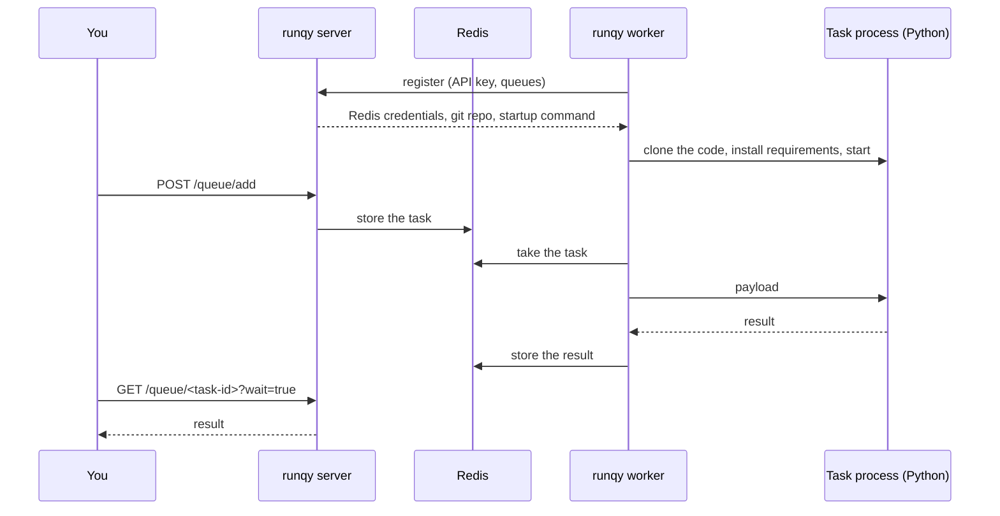

# Quickstart

Start a complete runqy setup on your machine, send a task to a worker and read its result.
The tasks are two small examples shipped with runqy; the [next page](first-task.md) replaces
them with your own code.

<div class="rq-facts" markdown>
<div><div class="rq-facts__label">Time</div><div class="rq-facts__value">About 5 minutes</div></div>
<div><div class="rq-facts__label">You need</div><div class="rq-facts__value">Docker with Compose, git, curl</div></div>
<div><div class="rq-facts__label">You get</div><div class="rq-facts__value">Server, worker, Redis and PostgreSQL on localhost</div></div>
</div>

## Start the stack

Clone the runqy repository and start the Compose file at its root:

```bash
git clone https://github.com/Publikey/runqy.git
cd runqy
docker compose -f docker-compose.quickstart.yml up -d
```

This starts four containers:

| Container | Role |
|-----------|------|
| `runqy-server` | The API, the CLI and the dashboard, on <http://localhost:3000> |
| `runqy-worker` | One worker, listening on the two example queues |
| `redis` | Holds the tasks and their results |
| `postgres` | Holds the queue configs |

The server loads two queues from [`examples/quickstart.yaml`](https://github.com/Publikey/runqy/blob/main/examples/quickstart.yaml).
Each queue config names a git repository, a directory in it and a command. The worker asks the
server what to run, clones that code, installs its requirements and starts it. Nothing about
the tasks is built into the worker image.

Wait until the worker reports that it is running (a few seconds once the images are pulled):

```bash
docker compose -f docker-compose.quickstart.yml logs -f runqy-worker
```

```text
[INFO] Queues: quickstart-longrunning.default (5), quickstart-oneshot.default (5)
[INFO] Worker running. Press Ctrl+C to stop.
```

Press ++ctrl+c++ to leave the logs; the containers keep running.

## Enqueue a task

Send a task to the `quickstart-oneshot` queue. `data` is the payload your task function
receives; this example task expects an `operation` and a value, also named `data`.

```bash
curl -s -X POST http://localhost:3000/queue/add \
  -H "Authorization: Bearer dev-api-key" \
  -H "Content-Type: application/json" \
  -d '{"queue": "quickstart-oneshot", "data": {"operation": "uppercase", "data": "hello world"}}'
```

The response describes the task. Keep its `id`:

```json
{
  "info": {
    "id": "66d9a415-0cd7-4fab-bddf-9100b1bd1ab1",
    "state": "pending",
    "queue": "quickstart-oneshot.default",
    "max_retry": 3
  },
  "data": {"operation": "uppercase", "data": "hello world"}
}
```

The response has more fields than shown here. The queue is named
`quickstart-oneshot.default` because every queue has at least one sub-queue; see
[Queues and priorities](../concepts/queues.md).

## Read the result

Ask for the task by id. With `?wait=true` the server holds the request until the task has
finished:

```bash
curl -s "http://localhost:3000/queue/<task-id>?wait=true"
```

```json
{
  "Info": {
    "id": "66d9a415-0cd7-4fab-bddf-9100b1bd1ab1",
    "state": "completed",
    "queue": "quickstart-oneshot.default",
    "CompletedAt": "2026-11-12T15:48:50Z",
    "Result": "{\"result\": \"HELLO WORLD\"}"
  }
}
```

`Result` is what the task function returned, as a JSON string. Again, the real response has
more fields; [Getting results](../guides/result-delivery.md) describes them.

## Keep a process alive between tasks

The first queue started a new Python process for the task and stopped it afterwards. The
second queue, `quickstart-longrunning`, keeps one process running: it prepares its resources
once, then handles every task. This is the mode to use for a model that takes time to load.

Send two tasks and look at `calls` in the results:

```bash
curl -s -X POST http://localhost:3000/queue/add \
  -H "Authorization: Bearer dev-api-key" \
  -H "Content-Type: application/json" \
  -d '{"queue": "quickstart-longrunning", "data": {"operation": "double", "data": 21}}'
```

```json
{"result": 42, "calls": 1}
```

The second task returns `"calls": 2`: the same process handled both. The code is in
[`examples/quickstart-longrunning/main.py`](https://github.com/Publikey/runqy/blob/main/examples/quickstart-longrunning/main.py).

## Look around

**The dashboard** is at <http://localhost:3000/monitoring/>. The first visit asks you to create
the administrator account. You then see the queues, the worker and its logs, and every task
with its payload and result.

**The CLI** is in the server container:

```bash
docker compose -f docker-compose.quickstart.yml exec runqy-server runqy queue list
```

```text
QUEUE                           PENDING  ACTIVE  SCHEDULED  RETRY  ARCHIVED  COMPLETED  PAUSED
quickstart-oneshot.default      0        0       0          0      0         1          no
quickstart-longrunning.default  0        0       0          0      0         2          no
```

```bash
docker compose -f docker-compose.quickstart.yml exec runqy-server runqy worker list
```

```text
WORKER_ID       STATUS   VERSION  QUEUES                          CONCURRENCY  LAST_BEAT  STALE
12f7363acae0:1  running  0.4.2    quickstart-longrunning.defa...  1            3s         no
```

## What just happened



## Stop and clean up

```bash
docker compose -f docker-compose.quickstart.yml down -v
```

`-v` also removes the volumes: the tasks, the queue configs and the dashboard account.

## Next steps

- [Your first task](first-task.md): run your own code from your own repository.
- [Architecture](../concepts/architecture.md): how the server, the workers and your code fit
  together.
- [Running without Docker](../guides/local-development.md): the same setup from the binaries.
- [Troubleshooting](../troubleshooting.md) if a step did not behave as described.
