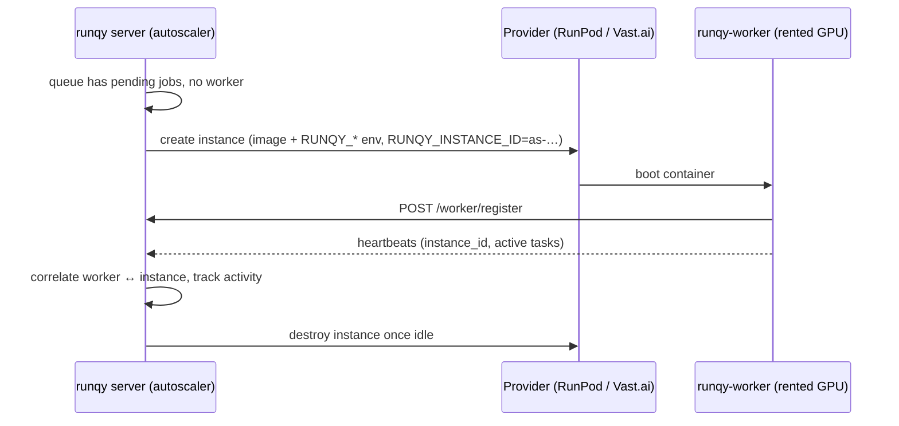

# GPU Autoscaling

runqy can **provision GPU workers on demand** for a queue and **destroy them when they are no
longer needed**. Instances are rented from a cloud provider (RunPod, Vast.ai), boot the
`runqy-worker` image, register with your server like any other worker, and are torn down once idle.

Autoscaling is configured **per parent queue** with an `autoscale` block, next to `deployment`.

## How it works



1. Every `poll_interval` (default 30s), the autoscaler reads the queue's pending/active jobs,
   latency and live workers.
2. If a **scale-up trigger** fires, it asks the provider for an instance. The machine boots the
   worker image with `RUNQY_SERVER_URL`, `RUNQY_API_KEY`, `RUNQY_QUEUES` and a correlation id
   `RUNQY_INSTANCE_ID`.
3. The worker registers and echoes its instance id in every heartbeat, along with how many tasks
   it is running. This is how the autoscaler links a worker to the machine it pays for.
4. When a **scale-down trigger** fires, idle instances are destroyed at the provider.

!!! info "Three identifiers"
    - **Instance id** (`as-…`): created by the autoscaler before renting the machine; shown in
      `runqy autoscale status` and the dashboard.
    - **Provider id**: the pod/contract id at RunPod or Vast.ai, used to query and destroy it.
    - **Worker id** (`host:pid`): chosen by the worker process when it starts.

## Prerequisites

| Requirement | Why |
|-------------|-----|
| `RUNQY_VAULT_MASTER_KEY` | Provider credentials are stored encrypted. Without it, providers cannot be created. |
| `RUNQY_PUBLIC_URL` | The URL the rented machine uses to reach your server (`http://localhost` is useless to a GPU in a datacenter). |
| `RUNQY_WORKER_API_KEY` | Sent to the rented machine. The **admin key is never sent** to third-party hosts. |
| Redis reachable from the internet | Workers receive the server's `REDIS_HOST:REDIS_PORT` at registration and connect directly. Protect it with a password and TLS. |

Real providers refuse to provision until `RUNQY_PUBLIC_URL` and `RUNQY_WORKER_API_KEY` are set
(the server logs the reason, and an `autoscale_failure` [alert](alerting.md) is raised). The
`mock` provider is exempt.

## 1. Register a provider

Providers are named configurations, created once and referenced by queues.

```bash
runqy autoscale providers create my-mock --type mock
runqy autoscale providers create gpu-runpod --type runpod \
  --config '{"api_key":"rpa_xxx","gpu_type_id":"NVIDIA GeForce RTX 4090","cloud_type":"SECURE"}'
runqy autoscale providers create gpu-vast --type vastai \
  --config '{"api_key":"xxx","gpu_name":"RTX 4090","max_price_per_hour":0.6}'
```

You can also manage providers from the dashboard's **Autoscaling** page. Secrets are masked when
read back; saving a form without retyping them keeps the stored values.

### Provider types

**`mock`** — dry run. Records instances and logs what it would do; boots nothing. Use it to test
your triggers. You can play the rented machine yourself by starting a worker with
`RUNQY_INSTANCE_ID=<as-…>`.

**`runpod`** — RunPod REST API.

| Key | Required | Description |
|-----|----------|-------------|
| `api_key` | yes | RunPod API key |
| `gpu_type_id` | no | Exact RunPod GPU id, e.g. `NVIDIA GeForce RTX 4090`. Takes precedence over the queue's `instance.gpu` |
| `gpu_type_ids` | no | Acceptable GPU ids in order of preference; RunPod rents the first available. Cheap types are often out of stock, so a list makes rentals much more reliable. Takes precedence over `gpu_type_id` |
| `cloud_type` | no | `SECURE` (default) or `COMMUNITY` |
| `container_disk_gb` | no | Used when the queue sets no `instance.disk_gb` |
| `volume_in_gb`, `volume_mount_path` | no | Optional persistent volume. None by default (RunPod would otherwise create and bill a 20 GB volume) |
| `min_cuda_version` | no | Restrict hosts to CUDA versions from this one up to `13.0` (off by default: RunPod matches exact versions and its API stops at 13.0, so recent hosts on CUDA 13.1+ would be excluded) |

**`vastai`** — Vast.ai marketplace: rents the **cheapest offer** matching the GPU, price and disk.

| Key | Required | Description |
|-----|----------|-------------|
| `api_key` | yes | Vast.ai API key |
| `gpu_name` | no | Vast GPU name, e.g. `RTX 4090` (`RTX_4090` is accepted too). Takes precedence over the queue's `instance.gpu` |
| `max_price_per_hour` | no | Price cap; takes precedence over the queue's `instance.max_price_per_hour` |
| `disk_gb` | no | Used when the queue sets no `instance.disk_gb` |
| `onstart` | no | Optional on-start script |
| `verified_only` | no | Rent only machines verified by Vast (default `true`) |
| `exclude_countries` | no | ISO country codes to avoid (default `["CN"]`: pulling from ghcr.io and cloning from GitHub is slow or blocked there). `[]` allows every country |
| `countries` | no | Allow-list of ISO country codes (overrides `exclude_countries`) |
| `min_download_mbps` | no | Minimum host download bandwidth (default `100`): the worker image weighs several GB |
| `min_cuda_version` | no | Only hosts whose driver supports this CUDA version (default `"12.8"`; `"none"` disables) |

The account may run machines runqy does not manage (e.g. hand-made production instances).
runqy only reads and destroys the instances it created, and refuses to destroy any instance
whose label (Vast.ai) or pod name (RunPod) does not start with `runqy-`.

!!! note "Why the provider wins for the GPU name"
    Each provider names GPUs differently, so the exact id lives in the provider configuration.
    The queue's `instance.gpu` is the generic fallback.

## 2. Enable autoscaling on a queue

```yaml
queues:
  inference:
    priority: 10
    deployment:
      git_url: "https://github.com/example/models.git"
      branch: "main"
      startup_cmd: "python main.py"
    autoscale:
      enabled: true
      provider: gpu-runpod
      min_workers: 0
      max_workers: 4
      poll_interval: "30s"
      boot_timeout: "20m"
      scale_up:
        - trigger: no_workers       # jobs pending and nobody listening -> 1 instance
        - trigger: queue_depth      # more than 50 pending -> one more instance
          threshold: 50
        - trigger: latency          # oldest pending job older than 5m -> one more instance
          max_latency: "5m"
        - trigger: schedule         # pre-warm 2 instances on weekdays at 08:00, held 10h
          cron: "0 8 * * 1-5"
          workers: 2
          duration: "10h"
      scale_down:
        - trigger: idle             # destroy an instance idle for 10m
          timeout: "10m"
        - trigger: schedule         # back to min_workers every night
          cron: "0 22 * * *"
      instance:
        gpu: "RTX 4090"
        image: "ghcr.io/publikey/runqy-worker:inference"
        disk_gb: 50
        max_price_per_hour: 0.60
```

The same block is editable in the dashboard (queue configuration → Autoscaling). A complete
example lives in [`examples/autoscale.yaml`](https://github.com/Publikey/runqy/blob/main/examples/autoscale.yaml).

### Options

| Option | Default | Description |
|--------|---------|-------------|
| `enabled` | `false` | Turn autoscaling on for this queue |
| `provider` | — | Name of a registered provider (required when enabled) |
| `min_workers` | `0` | Instances always kept |
| `max_workers` | — | Upper bound (required, ≥ 1) |
| `poll_interval` | `30s` | How often this queue is evaluated |
| `boot_timeout` | `20m` | An instance without a ready worker after this is destroyed |
| `instance.gpu` / `image` / `disk_gb` / `max_price_per_hour` | — | What to rent (see provider precedence above) |

### Scale-up triggers

| Trigger | Fields | Fires when |
|---------|--------|------------|
| `no_workers` | — | Jobs are pending and **no** live worker (managed or manual) serves the queue → at least 1 instance |
| `queue_depth` | `threshold` | More than `threshold` jobs pending → one more instance |
| `latency` | `max_latency` | The oldest pending job has waited longer than `max_latency` → one more instance |
| `schedule` | `cron`, `workers`, `duration` | The cron fired → at least `workers` instances, held for `duration` (default: one poll interval) |

### Scale-down triggers

| Trigger | Fields | Effect |
|---------|--------|--------|
| `idle` | `timeout` | Destroys instances whose worker has not started or finished a task for `timeout`, oldest first |
| `schedule` | `cron` | Goes back to `min_workers`, regardless of idleness (busy workers are still spared) |

Cron expressions use the standard 5 fields (`minute hour day month weekday`).

## Safety rules

The autoscaler spends real money, so it errs on the side of not leaking machines and not killing work.

**It never stacks instances.** While an instance is still booting, `queue_depth` and `latency`
hold the current count instead of adding one per poll. Provisioning failures (no offer, bad key,
price too low) back off exponentially: poll interval × 2ⁿ, capped at 10 minutes.

**It ignores paused work.** Pending jobs of a paused sub-queue do not count as load, so no
machine is rented for jobs no worker will take. `min_workers` and schedules still apply.

**It never destroys busy or protected workers.** Idleness is measured per instance from the
worker's own activity. A worker running a task, or one that touched a task in the last 30 seconds,
is never scaled down, not even by a `schedule`. Protected instances are skipped (see below).

**It drains before it destroys.** A scale-down first [drains](worker-control.md#drain-and-resume)
the worker: it stops taking tasks, and the machine is destroyed once the worker reports
`drained`. If new work arrives meanwhile and the instance is kept, the worker is resumed.
Workers older than runqy-worker v0.4.0 do not drain and are destroyed right away; a task they
picked up at that exact moment returns to the queue when its lease expires.

**It cleans up what it pays for.** An instance is destroyed and marked `failed` when:

- the provider reports it failed or terminated (it is destroyed anyway, e.g. to free Vast.ai storage);
- no worker became ready within `boot_timeout` (bad image, crash loop, dependency failure);
- its worker stopped heart-beating for 5 minutes (machine died or hung).

A teardown is recorded before calling the provider and retried every evaluation until the
provider confirms, so a provider error or a server restart cannot leave an untracked machine.

**It moves on from broken hosts.** On marketplaces like Vast.ai, some machines cannot start the
container at all (Docker or GPU errors on the host). Such an instance is destroyed as soon as the
provider reports it, its machine is avoided for 24 hours, and the next instance is rented after a
short pause (30s, doubling up to 10 minutes) instead of the boot-failure backoff below.

**It slows down when machines never boot.** When an instance is destroyed because no worker
became ready (bad image, task crashing at startup), the next instance waits `boot_timeout`, then
2×, 4×… up to one hour. Without it, a broken image would rent and pay for a new machine every
`boot_timeout`, forever. The first worker that becomes ready resets the pause. A machine that
worked and then died (preemption, crash) does not count.

**Pauses survive restarts.** The provisioning pauses above and the Vast.ai hosts to avoid are
kept in Redis (`runqy:autoscale:backoff`, `runqy:autoscale:provider-state:<provider>`): a server
restart, a new leader or a provider config change does not forget them and rent a broken setup
again.

**One server decides.** When several runqy servers share one Redis, a Redis lock elects a single
autoscaler.

## Protecting an instance

Protect an instance to keep it through scale-downs (debugging, a long warm-up you don't want to
redo):

```bash
runqy autoscale protect as-1234…
runqy autoscale unprotect as-1234…
```

A worker can also declare itself protected at boot with `RUNQY_PROTECTED=true`.

## Monitoring

```bash
runqy autoscale status
```

```
INSTANCE ID   QUEUE      PROVIDER    STATUS   WORKER          PROTECTED  COST
as-231d…      inference  gpu-runpod  running  a1b2c3:7        false      $0.4120
```

The dashboard's **Autoscaling** page shows the same, plus provider management. Instance states:
`provisioning` → `booting` → `running` → `draining` → `terminated`, or `failed` (with the reason in
its metadata). `booting` means the provider reports the machine up but no worker has registered
yet (image pull, dependency install). Costs are estimated from `max_price_per_hour` and the time each instance was alive.

Pair autoscaling with [alerts](alerting.md): the `autoscale_failure` rule emails you when
provisioning fails or an instance is destroyed for failure.

## Testing locally with the mock provider

1. Create a mock provider and point a queue at it (`provider: my-mock`, short `boot_timeout` and
   `idle` timeout for a quick test).
2. Enqueue a few tasks: the autoscaler creates an instance within one poll interval.
3. Copy its id from `runqy autoscale status` and start a worker as that machine:
   ```bash
   RUNQY_SERVER_URL=http://localhost:3000 RUNQY_API_KEY=<worker key> \
   RUNQY_QUEUES=inference RUNQY_INSTANCE_ID=as-… runqy-worker
   ```
4. Watch the instance get its worker, process the tasks, then be scaled down once idle. Stop
   the worker yourself afterwards; the mock cannot.
5. Don't start a worker for the next instance: after `boot_timeout` it is destroyed as `failed`.
