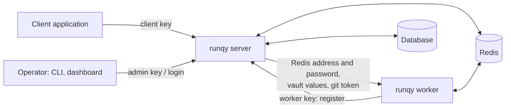

# Security

This page states who can do what in a runqy deployment, which parts are open by design, and where secrets travel. It ends with a hardening checklist. For the deployment itself, see [Production deployment](production.md).

## The trust model in short

Three facts follow from this design:

1. **Redis is the trust boundary.** Whoever can connect to Redis can read every task payload and result, enqueue tasks, and send control commands to workers.
2. **A worker key is powerful.** Registering a worker returns the Redis address and password, plus the decrypted vault entries and git token of the queue asked for.
3. **Task code is arbitrary code.** A worker runs whatever the queue's git repository contains, with the worker's own privileges. Anyone who can edit a queue config, or push to its repository and branch, runs code on your workers.

## API keys

The server accepts a key in the `Authorization: Bearer <key>` header or in `X-API-Key`. There are three keys, each an environment variable on the server:

| Key | Variable | Can do |
|-----|----------|--------|
| Admin | `RUNQY_API_KEY` | Everything: all endpoints below, plus queue configs, workers, vaults, autoscaling, alerts, worker control and the CLI API under `/api`. |
| Worker | `RUNQY_WORKER_API_KEY` | `POST /worker/register` only. |
| Client | `RUNQY_CLIENT_API_KEY` | `POST /queue/add` and `POST /queue/add-batch` only. |

- A valid key used on an endpoint outside its role gets `403`; an unknown or missing key gets `401`.
- The worker and client keys are optional. If one is not set, only the admin key works for that role.
- If `RUNQY_API_KEY` is not set, every authenticated endpoint rejects every request.

Give each party the narrowest key: the client key to applications that enqueue, the worker key to worker machines, the admin key to operators only. The endpoints are listed in the [REST API reference](../reference/rest-api.md).

### What the worker key gives access to

`POST /worker/register` takes a queue name and returns, for that queue:

- the Redis address, password and TLS setting of the server;
- the deployment spec (git URL, branch, startup command);
- the decrypted entries of every vault the queue references;
- the git token, when the queue has a `git_token`.

A holder of the worker key can ask for any queue. Treat the worker key as giving access to Redis and to every secret attached to a queue.

## Endpoints that need no key

| Endpoint | Exposes |
|----------|---------|
| `GET /health`, `GET /healthz` | Liveness, and whether Redis answers. |
| `GET /metrics` | Prometheus metrics: queue names, task counts, worker counts. |
| `GET /queue/<task-id>` | The task's state, **payload**, error and result. The task id is the only credential. |
| `GET /swagger/*`, `GET /swagger.yaml` | The API description. |
| `/monitoring` | The dashboard's static files and its login endpoints. Everything else under `/monitoring/api` requires a dashboard session. |

What to do about them:

- Restrict `/metrics` and `/swagger` at the reverse proxy to your monitoring system or internal network.
- Treat task ids as secrets: anyone who learns one can read that task's payload and result until the task expires. Do not log them where others can read them, and do not hand them to parties who should not see the payload.
- The API answers cross-origin requests from any origin (it sends permissive CORS headers). Do not embed an API key in a web page.

## Redis

Tasks never pass through the server once enqueued: workers read them from Redis and write results back. Redis holds payloads and results in clear text.

- Keep Redis on a private network, require a password (`REDIS_PASSWORD`) and use TLS (`REDIS_TLS=true`) when the path between workers and Redis is not trusted.
- Worker control commands (`drain`, `code_update`, `worker_update`, `config_reload`) are published on Redis Pub/Sub channels. Anyone who can publish on your Redis can send them. See [Worker control](../guides/worker-control.md).
- Every worker holds the Redis password after registration. A compromised worker machine means a compromised Redis: rotate the Redis password and the worker key.

## Autoscaled machines

With [GPU autoscaling](../guides/autoscaling.md), the server boots workers on machines rented from a provider and passes them the server URL and an API key.

- The server never sends the admin key to a rented machine. For real providers (RunPod, Vast.ai) it refuses to provision unless `RUNQY_WORKER_API_KEY` and `RUNQY_PUBLIC_URL` are set. Only the dry-run `mock` provider, which boots nothing, is exempt.
- The rented machine then registers like any worker, so it receives the Redis password and the queue's vault entries. Choose providers and hosts accordingly, and make sure Redis accepts connections from them over TLS.
- Provider credentials (API keys) are stored encrypted in the database with the vault master key.

## Secrets

### Vaults

[Vaults](../guides/vaults.md) hold the secrets your tasks need.

- Entries are encrypted at rest in the database with AES-256-GCM, using the 32-byte key in `RUNQY_VAULT_MASTER_KEY` and a random nonce per value. The key is not stored in the database: without it the entries cannot be decrypted, and losing it loses them.
- The API, the CLI and the dashboard show secret entries masked. `runqy vault get` returns a clear value in local mode only, on a machine that has the master key and database access.
- At registration the server decrypts the entries of the queue's vaults and sends them to the worker in the HTTP response. Serve the API over HTTPS, otherwise they cross the network in clear.
- The worker passes them to the task process as environment variables. Task code, and any library it loads, can read them.

### Git tokens

- A queue's `git_token` must be a `vault://<vault>/<key>` reference; a literal value is ignored and the clone is attempted without a token.
- The worker embeds the token in the clone URL, so it is stored in the `.git/config` of the deployment directory on the worker machine.
- The worker redacts the token from its logs (runqy-worker v0.3.1 or later). Earlier versions could log it: rotate tokens that were used with them.
- With `RUNQY_GIT_SSH_KEY`, the worker runs ssh with host key checking disabled.

### Alert delivery secrets

SMTP passwords and SendGrid keys can be given as a vault reference, as an environment variable on the server, or as a literal that is stored encrypted, which requires `RUNQY_VAULT_MASTER_KEY`. See [Email alerts](../guides/alerting.md).

### CLI credentials

`runqy login` saves the server URL and API key in `~/.runqy/credentials.json`, readable by the current user only. Remove them with `runqy logout`.

## Dashboard authentication

The dashboard at `/monitoring` has its own login, separate from API keys.

- **The first visitor creates the admin account.** Until an account exists, the setup endpoint is open to anyone who can reach the server. Open the dashboard and create the account before exposing the server. There is one account, with an email and a password of at least 8 characters, stored as a bcrypt hash.
- A logged-in session can do what the admin key can do through the dashboard: edit queue configs, manage vaults, send worker control commands, enqueue tasks.
- The session is a signed token in an `HttpOnly`, `SameSite=Lax` cookie valid for 7 days. It is signed with `RUNQY_JWT_SECRET`. If the variable is not set, the server generates a random secret at each start, so every session ends at restart.
- The cookie is not marked `Secure`. Serve the dashboard over HTTPS only, and redirect HTTP to HTTPS at the proxy.
- `runqy serve --no-ui` disables the dashboard entirely, for API-only servers.

## Payloads

Payloads and results are stored in Redis in clear text, returned by `GET /queue/<task-id>` without a key, and shown in the dashboard.

- Do not put credentials in payloads. Give tasks their secrets through vaults.
- For sensitive inputs, pass a reference (an object storage URL, a record id) and let the task fetch the data with its own credentials.
- Results follow the same rule. A queue stores results in Redis only when `redis_storage` is true; see [Getting results](../guides/result-delivery.md). Shorten `ttl_completed` and `ttl_archived` to limit how long data stays: see [Task lifecycle](../guides/task-lifecycle.md).

## Hardening checklist

- Serve the API and dashboard over HTTPS behind a reverse proxy; redirect HTTP.
- Set three distinct, random API keys; hand out the admin key to operators only.
- Create the dashboard account before the server is reachable from outside; set `RUNQY_JWT_SECRET`.
- Restrict `/metrics` and `/swagger` at the proxy.
- Keep Redis private, with a password and TLS; never expose it to the internet without both.
- Keep PostgreSQL private, with `DATABASE_SSL` set when it is on another host.
- Set `RUNQY_VAULT_MASTER_KEY`, store it in a secrets manager, and back it up separately from the database.
- Use vaults for task secrets and git tokens; keep secrets out of payloads and out of queue YAML files.
- Use a dedicated, read-only deploy token or key for task repositories, and protect the branches workers deploy from.
- Pin image versions for the server and workers, and keep them up to date: see [Upgrading and compatibility](upgrading.md).

## Reporting a vulnerability

Do not open a public issue. Report privately by email or through GitHub's private vulnerability reporting, as described in the project's [security policy](https://github.com/Publikey/runqy/blob/main/SECURITY.md).
